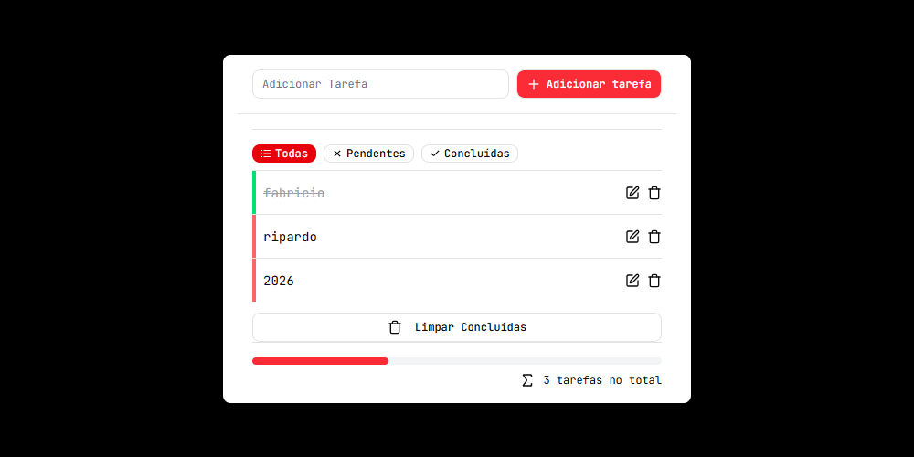
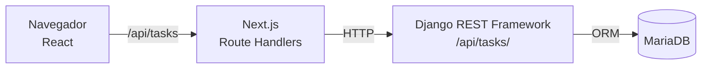

# Lista de Tarefas — Full-stack

Gerenciador de tarefas com **front-end em Next.js** e **API REST em Django REST Framework**, com dados persistidos no **MariaDB**.

<!-- Dica: adicione um print da tela em docs/screenshot.png e descomente a linha abaixo -->
<!--  -->

## Funcionalidades

- Criar, editar e excluir tarefas
- Marcar tarefas como concluídas
- Filtrar por **todas**, **pendentes** e **concluídas**
- Barra de progresso das tarefas concluídas
- Limpar todas as concluídas, com diálogo de confirmação
- Validação no back-end (título obrigatório, sem espaços extras, até 255 caracteres)

## Stack

| Camada | Tecnologias |
| --- | --- |
| Front-end | Next.js 16, React 19, TypeScript, Tailwind CSS, shadcn/ui, Axios |
| Back-end | Python, Django, Django REST Framework |
| Banco de dados | MariaDB |
| Testes | Django `APITestCase`, coleção no Postman |
| Infra | Docker, Docker Compose |

## Arquitetura



O navegador nunca fala direto com o Django: as rotas `app/api/tasks` do Next.js recebem as requisições e repassam para a API. Isso centraliza o tratamento de erros e deixa o endereço do back-end só no servidor.

## Endpoints da API

Base: `http://localhost:8000/api`

| Método | Rota | Descrição |
| --- | --- | --- |
| `GET` | `/tasks/` | Lista todas as tarefas |
| `POST` | `/tasks/` | Cria uma tarefa — `{ "title": "Estudar Django" }` |
| `GET` | `/tasks/{id}/` | Busca uma tarefa |
| `PUT` | `/tasks/{id}/` | Atualiza uma tarefa inteira |
| `PATCH` | `/tasks/{id}/` | Atualiza campos específicos — `{ "completed": true }` |
| `DELETE` | `/tasks/{id}/` | Exclui uma tarefa |

A coleção do Postman com essas requisições está em [`postman/collections/Lista de Tarefas API`](postman/collections/Lista%20de%20Tarefas%20API).

## Como rodar

### Opção 1 — Docker (mais simples)

Com o [Docker](https://www.docker.com/) instalado:

```bash
docker compose up --build
```

- Front-end: http://localhost:3000
- API: http://localhost:8000/api/tasks/

### Opção 2 — Manualmente

Pré-requisitos: Node.js 20+, Python 3.12+ e MariaDB rodando com um banco chamado `lista_de_tarefas`.

**Back-end**

```bash
cd backend
python -m venv .venv
.venv\Scripts\activate          # Windows  (Linux/macOS: source .venv/bin/activate)
pip install -r requirements.txt
cp .env.example .env            # e preencha a senha do seu MariaDB
python manage.py migrate
python manage.py runserver
```

**Front-end** (em outro terminal, na raiz do projeto)

```bash
npm install
npm run dev
```

Acesse http://localhost:3000.

## Testes

Os testes da API rodam em um banco SQLite em memória, então não precisam do MariaDB ligado:

```bash
cd backend
python manage.py test
```

Cobrem listagem, criação, validações (título vazio, em branco e acima de 255 caracteres), busca por id, edição com `PUT` e `PATCH`, exclusão e respostas `404` para tarefas inexistentes.

## Histórico do projeto

1. Interface estática em Next.js com shadcn/ui
2. Primeira versão da API em **Spring Boot** + MariaDB, com Docker
3. Back-end migrado para **Python com Django REST Framework**, sem precisar reescrever o front-end

## Autor

**Fabricio Ripardo** — [LinkedIn](https://www.linkedin.com/in/fabricio-ripardo-688082265) · [GitHub](https://github.com/Fabricio-Ripardo)
